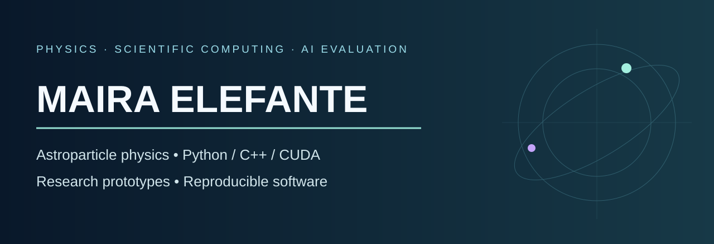

# Maira Elefante

**Physicist first. Scientific software and AI evaluation as tools for solving research problems.**

I'm a physicist with a BSc in Physics from Roma Tre and MSc studies in **Physics of Fundamental Interactions at Sapienza University of Rome**, focused on astroparticle physics and relativity.

My interests span **dark matter, particle astrophysics, gravitational waves, numerical simulation and scientific machine learning**. I work with Python, C++, CUDA, scientific data analysis, software evaluation and interactive simulation.

## Featured research and engineering projects

| Project | What it demonstrates |
|---|---|
| [WIMP Earth Transport](https://github.com/Mairaelefante/wimp-earth-transport) | Monte Carlo modeling of dark-matter scattering through terrestrial matter and xenon recoil calculations |
| [CUDA N-Body Galaxy Simulator](https://github.com/Mairaelefante/cuda-nbody-galaxy-simulator) | C++/CUDA gravitational simulation, CPU reference implementation and benchmarking |
| [When AI Gets Physics Wrong](https://github.com/Mairaelefante/when-ai-gets-physics-wrong) | Scientific AI evaluation with independent numerical references and deterministic grading |
| [AI Legacy Last-Mile Agent](https://github.com/Mairaelefante/ai-legacy-last-mile-agent) | Research prototype for agentic reconciliation with deterministic operational safeguards |
| [AI-Assisted Robotic Arm](https://github.com/Mairaelefante/ai-robotic-arm-mechatronics) | Two-link inverse kinematics, motion planning, PID simulation and testing |
| [Gravitational Wave Simulator](https://github.com/Mairaelefante/gravitational-wave-simulator) | Gravitational-wave modeling and computational physics |
| [Sentinel-2 Geospatial Analysis](https://github.com/Mairaelefante/sentinel2-geospatial-analysis) | Satellite imagery analysis and geospatial workflows |

## Background

- **Astroparticle physics:** dark-matter phenomenology, resonant-cavity instrumentation and direct-detection modeling.
- **Astrophysics:** bachelor's thesis research on high-redshift active galactic nuclei, with JWST and X-ray analysis.
- **Scientific programming:** Python, NumPy, SciPy, pandas, Matplotlib, C++, CUDA, numerical verification and simulation.
- **AI evaluation:** numerical benchmark design, rubric development, controlled trials and traceable evidence.
- **Interactive programming:** Panda3D, Solar2D and other game-engine prototypes.

The repositories include research studies, educational prototypes, exploratory implementations and software experiments. Each should be judged against its documented scope, not as a claim of production deployment.

## Explore by theme

**[Computational physics](https://github.com/Mairaelefante?tab=repositories&q=physics)** · **[CUDA](https://github.com/Mairaelefante/cuda-nbody-galaxy-simulator)** · **[AI & evaluation](https://github.com/Mairaelefante/when-ai-gets-physics-wrong)** · **[Game development](https://github.com/Mairaelefante?tab=repositories&q=panda)**

## Connect

[GitHub](https://github.com/Mairaelefante) · [LinkedIn](https://www.linkedin.com/in/maira-elefante-4a6a33185/)

*This is a portfolio overview. The source code, computational assumptions, tests and limitations are documented inside the individual repositories.*
